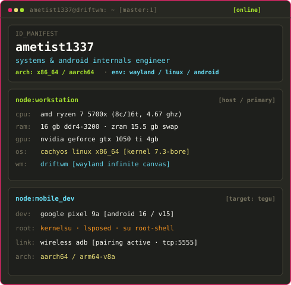
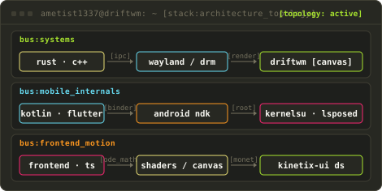
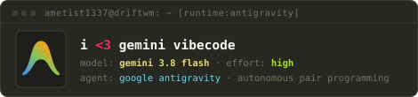

# `ametist1337`

 

<!-- Hyprland Master/Stack Tiling Workspace -->
<table>
  <tr>
    <td rowspan="3" valign="top">
      
    </td>
    <td valign="top">
      
    </td>
  </tr>
  <tr>
    <td valign="top">
      
    </td>
  </tr>
  <tr>
    <td valign="top">
      
    </td>
  </tr>
</table>

 

