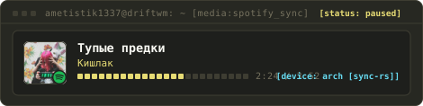

<div align="center">

# `ametist`

```text
systems & android internals engineer · cachyos linux · driftwm · kinetix-ds
```

<br/>

<!-- Hyprland Master/Stack Tiling Workspace -->
<table>
  <tr>
    <td rowspan="3" valign="top">
      
    </td>
    <td valign="top">
      
    </td>
  </tr>
  <tr>
    <td valign="top">
      
    </td>
  </tr>
  <tr>
    <td valign="top">
      
    </td>
  </tr>
</table>

<br/>

```text
status: active · wm: driftwm (wayland) · stack: rust / kotlin / c++ / ts
cluster: workstation (5700x) · mobile_dev (pixel 9a) · gpu_node (4060 ti)
spec: kinetix-ds v1.2 · zero-slop engineering
```

</div>
